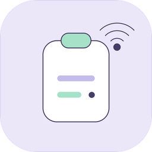
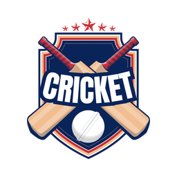
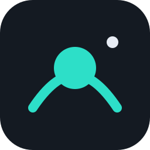

<h1 align="center">Hi 👋, I'm Muhammad Abu Huraira</h1>
<h3 align="center">Computer Science Graduate (FAST NUCES) | AI/ML, Flutter & Full-Stack SaaS Engineer</h3>

<p align="center">
  <a href="mailto:huraira.eqeel@gmail.com">
    
  </a>
  <a href="https://www.linkedin.com/in/muhammad-abu-huraira-a44a60248/">
    
  </a>
  <a href="https://portfolio-m-abu-huraira.vercel.app/">
    
  </a>
  
</p>

## About Me

I'm a **FAST NUCES Computer Science graduate** based in Lahore, Pakistan, focused on building end-to-end **AI/ML systems**, **full-stack SaaS platforms**, and **cross-platform Flutter & desktop applications**. At **RaftWorks**, I delivered the LLM-powered **FieldQuote** quoting SaaS and a Next.js/Supabase client portal (**RaftWorks Health**) with Stripe billing, Row-Level Security audits, and Cloudflare Worker / Vercel CI/CD pipelines.

My engineering work spans fine-tuning multimodal models (**LocalCUA** — Qwen3-VL-8B trained with Unsloth LoRA & GRPO to **76.97% ScreenSpot** as a 100% local desktop agent), building hallucination-resistant clinical RAG pipelines (**FastAPI + FAISS + Gemini/Ollama**), quantizing on-device sports ML models to **22.8 KB** (**80.7% accuracy, 0.887 ROC-AUC** in TFLite/ONNX), and shipping offline-first encrypted apps like **Notlyfe**, **Health Max**, **WiFi Sync**, and **Lumen**.

- **Core Focus:** AI/LLM Engineering (RAG, Fine-Tuning, Computer Use Agents) & Cross-Platform Mobile/SaaS Engineering
- **Open To:** Software / AI / Flutter Engineering roles (Lahore on-site/hybrid or Remote worldwide)
- **Reach Me:** [huraira.eqeel@gmail.com](mailto:huraira.eqeel@gmail.com)

---

<!-- TOP FEATURED PROJECTS (4 + 3 GRID SHOWCASE) -->
# 🌟 Featured Projects & Platforms

<table align="center" width="100%">
  <tr>
    <td align="center" width="25%" valign="top">
      <a href="https://github.com/hurairamuzammal/Field-Quote">
        <br/>
        <b>FieldQuote</b>
      </a><br/>
      <sub>AI-Powered Field Service Quoting & Operations SaaS</sub>
    </td>
    <td align="center" width="25%" valign="top">
      <a href="https://github.com/hurairamuzammal/Notlyfe-Student-Oragnizer">
        <br/>
        <b>Notlyfe</b>
      </a><br/>
      <sub>E2EE Offline-First Student Workspace (Android, Linux & Windows)</sub>
    </td>
    <td align="center" width="25%" valign="top">
      <a href="https://github.com/hurairamuzammal/localcua">
        <br/>
        <b>LocalCUA</b>
      </a><br/>
      <sub>Fine-Tuned Qwen3-VL-8B Local Computer Use Agent</sub>
    </td>
    <td align="center" width="25%" valign="top">
      <a href="https://github.com/hurairamuzammal/WiFi-Sync">
        <br/>
        <b>WiFi Sync</b>
      </a><br/>
      <sub>Sub-Second Cross-Device Clipboard & Remote Hub</sub>
    </td>
  </tr>
</table>

<table align="center" width="80%">
  <tr>
    <td align="center" width="33.3%" valign="top">
      <a href="https://github.com/hurairamuzammal/Flutter-Projects-Collection">
        <br/>
        <b>Health Max</b>
      </a><br/>
      <sub>Flutter Activity & Health Tracker with Home Widgets & Insights</sub>
    </td>
    <td align="center" width="33.3%" valign="top">
      <a href="https://github.com/hurairamuzammal/Cricket-world">
        <br/>
        <b>Cricket World</b>
      </a><br/>
      <sub>Live Match Analytics & 22.8 KB On-Device ML Win Predictor</sub>
    </td>
    <td align="center" width="33.3%" valign="top">
      <a href="https://github.com/hurairamuzammal/linux-lumen">
        <br/>
        <b>Lumen</b>
      </a><br/>
      <sub>Native Linux Digital Wellbeing & Battery Telemetry (C11 / GTK 4)</sub>
    </td>
  </tr>
</table>

---

# 🛠️ Tech Stack


---

# 📈 Activity


---

# 🗺️ Portfolio Repository Map

```text
📦 Muhammad Abu Huraira — AI/ML, Flutter & Full-Stack Systems Engineer
│
├── ☁️ SaaS & Full-Stack Platforms
│   ├── Field-Quote (AI-Driven Field Service Quoting & Operations SaaS)
│   │   ├── Voice Dictation & Multi-Image Ingestion (Whisper + Cloudflare R2)
│   │   ├── Multi-Modal AI Proposal Generation + Deterministic Price Book Engine
│   │   └── Supabase Auth/RLS, Stripe Billing & Make.com Workflows
│   └── Portfolio (Interactive Space-Themed Engineering Showcase)
│
├── 📱 Flutter & Cross-Platform Apps
│   ├── Notlyfe-Student-Oragnizer (E2EE Offline-First Workspace — Android, Linux & Windows)
│   ├── Health Max (Flutter Activity, Steps, Calories & Insights App with Home Widgets)
│   ├── WiFi-Sync (Sub-Second Multi-Device Clipboard & Device Hub)
│   ├── Cricket-world (Live Match Analytics & 22.8 KB On-Device TFLite/ONNX Predictor)
│   └── Flutter-Projects-Collection
│
├── 🤖 AI / ML & NLP Engineering
│   ├── localcua (Qwen3-VL-8B Fine-Tuned Offline Computer Use Agent — 76.97% ScreenSpot)
│   ├── NLP-RAG-medical-LLM (Clinical Dual-FAISS RAG API with Refusal Gate)
│   └── AI_ML-Projects_Collection
│       ├── GENAI-Qwen2-vl-finetuning-ocr
│       ├── GENAI-GANS-sketch-to-image
│       ├── GENAI-LSTM-BiLSTM-image_captioning
│       ├── NLP-Transformer_using_Pytorch
│       ├── NLP_Finetuning_Bert_GPT2_T5
│       └── NLP-LSTM-BiLSTM-Urdu-to-RomanUrdu
│
├── 💻 Native Linux & Systems
│   ├── linux-lumen (Native Linux Digital Wellbeing & Battery Telemetry in C11 / GTK 4)
│   └── WiFi-Sync Desktop Daemon (Linux systemd agent & Windows tray)
│
├── 🧪 Software Testing & QA
│   ├── ST-LocalCUA-mutation-testing
│   └── Text-Editor-ST
│
└── 🖥️ Android Java & .NET Desktop
    ├── Java-Android-Development-Tasks
    ├── Flex-Managment-System (C# WinForms)
    └── Flight-Management-System (.NET 8.0 WinForms)
```

---

## 📊 Repository Overview

| Domain | Key Repositories | Focus Area |
| :--- | :--- | :--- |
| **☁️ SaaS / Cloud** | [Field-Quote](https://github.com/hurairamuzammal/Field-Quote), [Portfolio](https://github.com/hurairamuzammal/Portfolio) | AI-Driven Field Service Quoting SaaS (Next.js, Bubble.io, Supabase, Stripe, Cloudflare) |
| **📱 Mobile & Cross-Platform** | [Notlyfe-Student-Oragnizer](https://github.com/hurairamuzammal/Notlyfe-Student-Oragnizer), **Health Max**, [WiFi-Sync](https://github.com/hurairamuzammal/WiFi-Sync), [Cricket-world](https://github.com/hurairamuzammal/Cricket-world) | E2EE Offline-First Flutter Apps, Health Tracking, Sub-Second Sync, On-Device ML |
| **🤖 AI / ML & Agents** | [localcua](https://github.com/hurairamuzammal/localcua), [NLP-RAG-medical-LLM](https://github.com/hurairamuzammal/NLP-RAG-medical-LLM), [AI_ML-Projects_Collection](https://github.com/hurairamuzammal/AI_ML-Projects_Collection) | Vision-Language Fine-Tuning (LoRA/GRPO), Clinical FAISS RAG, PyTorch Transformers |
| **💻 Native Systems** | [linux-lumen](https://github.com/hurairamuzammal/linux-lumen) | Lightweight C11 Telemetry Collector & GTK 4 / libadwaita Desktop Dashboard |
| **🧪 QA & Testing** | [ST-LocalCUA-mutation-testing](https://github.com/hurairamuzammal/ST-LocalCUA-mutation-testing), [Text-Editor-ST](https://github.com/hurairamuzammal/Text-Editor-ST) | Mutation Testing, Automated QA Suites, RLS Security Audits |
| **🖥️ Android & .NET** | [Java-Android-Development-Tasks](https://github.com/hurairamuzammal/Java-Android-Development-Tasks), [Flex-Managment-System](https://github.com/hurairamuzammal/Flex-Managment-System) | Native Android Fundamentals & .NET 8.0 WinForms Systems |

**Total Repositories: 25+ Production & Engineering Projects**
