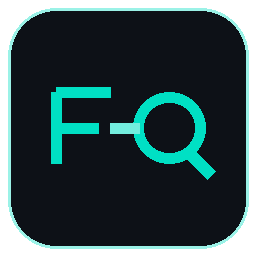

<h1 align="center">Hi 👋, I'm Muhammad Abu Huraira</h1>
<h3 align="center">Computer Science Graduate (FAST NUCES) | AI/ML, Flutter & Full-Stack SaaS Engineer</h3>

<p align="center">
  <a href="mailto:huraira.eqeel@gmail.com">
    
  </a>
  <a href="https://www.linkedin.com/in/muhammad-abu-huraira-a44a60248/">
    
  </a>
  <a href="https://portfolio-m-abu-huraira.vercel.app/">
    
  </a>
  
</p>

## About Me

I'm a **FAST NUCES Computer Science graduate** based in Lahore, Pakistan, focused on building end-to-end **AI/ML systems**, **full-stack SaaS platforms**, and **cross-platform Flutter & desktop applications**. At **RaftWorks**, I delivered the LLM-powered **FieldQuote** quoting SaaS and a Supabase/Google Cloud client portal (**RaftWorks Health**) with Stripe billing, Row-Level Security audits, and Cloudflare Worker / Vercel CI/CD pipelines.

My engineering work spans fine-tuning multimodal models (**LocalCUA** — Qwen3-VL-8B trained with Unsloth LoRA & GRPO to **76.97% ScreenSpot** as a 100% local desktop agent), building hallucination-resistant clinical RAG pipelines (**FastAPI + FAISS + Gemini/Ollama**), quantizing on-device sports ML models to **22.8 KB** (**80.7% accuracy, 0.887 ROC-AUC** in TFLite/ONNX), and shipping offline-first encrypted apps like **Notlyfe**, **WiFi Sync**, **Lumen**, and **Health Max**.

- **Core Focus:** AI/LLM Engineering (RAG, Fine-Tuning, Computer Use Agents) & Cross-Platform Mobile/SaaS Engineering
- **Open To:** Software / AI / Flutter Engineering roles (Lahore on-site/hybrid or Remote worldwide)
- **Reach Me:** [huraira.eqeel@gmail.com](mailto:huraira.eqeel@gmail.com)

---

<!-- TOP FEATURED PROJECTS (4 + 4 GRID SHOWCASE WITH HOVER STACK TOOLTIPS) -->
# 🌟 Featured Projects & Platforms
<sub>Hover over any project icon or title to view its full summary & tech stack.</sub>

<table align="center" width="100%">
  <tr>
    <td align="center" width="25%" valign="top">
      <a href="https://github.com/hurairamuzammal/Field-Quote" title="AI-powered field-service quoting SaaS turning voice/text requests into itemized quotes in under 2 minutes. | Stack: Bubble.io, Supabase, PostgreSQL, Stripe, Make.com, Cloudflare R2, LLM APIs">
        <br/>
        <b>FieldQuote</b>
      </a><br/>
      <sub>AI Field Service Quoting & Operations SaaS</sub>
    </td>
    <td align="center" width="25%" valign="top">
      <a href="https://github.com/hurairamuzammal/localcua" title="100% offline desktop Computer Use Agent fine-tuned on 200k GUI trajectories (76.97% ScreenSpot, 31.4% OSWorld). | Stack: Python, PyTorch, Qwen3-VL-8B, Unsloth LoRA, GRPO, Hugging Face, PyAutoGUI">
        <br/>
        <b>LocalCUA</b>
      </a><br/>
      <sub>Fine-Tuned Qwen3-VL-8B Desktop Agent</sub>
    </td>
    <td align="center" width="25%" valign="top">
      <a href="https://github.com/hurairamuzammal/Notlyfe-Student-Oragnizer" title="End-to-end encrypted (AES-256 + HMAC) offline-first student workspace for Android, Linux & Windows with persistent Google Drive and pluggable WebDAV/HTTP/Local storage. | Stack: Flutter, Dart, Riverpod, SQLite/FFI, Supabase RLS, Google Drive API">
        <br/>
        <b>Notlyfe</b>
      </a><br/>
      <sub>E2EE Offline-First Student Workspace</sub>
    </td>
    <td align="center" width="25%" valign="top">
      <a href="https://github.com/hurairamuzammal/NLP-RAG-medical-LLM" title="Clinical diagnostic RAG API with dual FAISS indexes (medical guidelines + MIMIC-IV cases) and a refusal gate to prevent hallucinations. | Stack: Python, FastAPI, FAISS, nomic-embed-text-v1.5, Gemini API, Ollama, DeepSeek, Streamlit">
        <br/>
        <b>Medical RAG</b>
      </a><br/>
      <sub>Clinical Dual-FAISS RAG & Refusal Gate</sub>
    </td>
  </tr>
  <tr>
    <td align="center" width="25%" valign="top">
      <a href="https://github.com/hurairamuzammal/Cricket-world" title="Live cricket analytics mobile app with automated ESPN ETL and 22.8 KB quantized on-device win-prediction models (80.7% accuracy, 0.887 ROC-AUC). | Stack: Flutter, Dart, Riverpod, Python, TensorFlow, Scikit-learn, TFLite, ONNX">
        <br/>
        <b>Cricket World</b>
      </a><br/>
      <sub>Live Analytics & 22.8 KB On-Device ML</sub>
    </td>
    <td align="center" width="25%" valign="top">
      <a href="https://github.com/hurairamuzammal/WiFi-Sync" title="Private cross-platform clipboard synchronizer & device hub bridging Android, Linux systemd daemon, and Windows with sub-second sync. | Stack: Flutter, Dart, Firebase, Python/Linux systemd, Cross-Platform Desktop">
        <br/>
        <b>WiFi Sync</b>
      </a><br/>
      <sub>Sub-Second Cross-Device Clipboard Hub</sub>
    </td>
    <td align="center" width="25%" valign="top">
      <a href="https://github.com/hurairamuzammal/linux-lumen" title="Privacy-first native Linux digital wellbeing & battery telemetry suite featuring a ~32 KB C11 collector and GTK 4 / libadwaita dashboard. | Stack: C11, GTK 4, libadwaita, SQLite, GNOME / Linux systemd">
        <br/>
        <b>Lumen</b>
      </a><br/>
      <sub>Native Linux Wellbeing & Battery Telemetry</sub>
    </td>
    <td align="center" width="25%" valign="top">
      <a href="https://github.com/hurairamuzammal/Flutter-Projects-Collection" title="Cross-platform health & activity tracker syncing steps, calories, and distance with native Android home-screen widgets and offline persistence. | Stack: Flutter, Dart, Health Connect, Firebase Auth, Cloud Firestore, Provider">
        <br/>
        <b>Health Max</b>
      </a><br/>
      <sub>Flutter Activity Tracker & Home Widgets</sub>
    </td>
  </tr>
</table>

---

# 🛠️ Tech Stack

### 🤖 AI, Machine Learning & Data


### 📱 Mobile, Systems & Languages


### ☁️ Databases, Cloud & DevOps


---

# 📈 Activity


---

# 🗺️ Portfolio Repository Map

```text
📦 Muhammad Abu Huraira — AI/ML, Flutter & Full-Stack Systems Engineer
│
├── ☁️ SaaS & Full-Stack Platforms
│   ├── Field-Quote (AI-Driven Field Service Quoting & Operations SaaS)
│   │   ├── Voice Dictation & Multi-Image Ingestion (Whisper + Cloudflare R2)
│   │   ├── Multi-Modal AI Proposal Generation + Deterministic Price Book Engine
│   │   └── Supabase Auth/RLS, Stripe Billing & Make.com Workflows
│   └── Portfolio (Interactive Space-Themed Engineering Showcase)
│
├── 🤖 AI / ML & NLP Engineering
│   ├── localcua (Qwen3-VL-8B Fine-Tuned Offline Computer Use Agent — 76.97% ScreenSpot)
│   ├── NLP-RAG-medical-LLM (Clinical Dual-FAISS RAG API with Refusal Gate)
│   └── AI_ML-Projects_Collection
│       ├── GENAI-Qwen2-vl-finetuning-ocr
│       ├── GENAI-GANS-sketch-to-image
│       ├── GENAI-LSTM-BiLSTM-image_captioning
│       ├── NLP-Transformer_using_Pytorch
│       ├── NLP_Finetuning_Bert_GPT2_T5
│       └── NLP-LSTM-BiLSTM-Urdu-to-RomanUrdu
│
├── 📱 Flutter & Cross-Platform Apps
│   ├── Notlyfe-Student-Oragnizer (E2EE Offline-First Workspace — Android, Linux & Windows)
│   ├── Cricket-world (Live Match Analytics & 22.8 KB On-Device TFLite/ONNX Predictor)
│   ├── WiFi-Sync (Sub-Second Multi-Device Clipboard & Device Hub)
│   ├── Health Max (Flutter Activity, Steps, Calories & Insights App with Home Widgets)
│   └── Flutter-Projects-Collection
│
├── 💻 Native Linux & Systems
│   ├── linux-lumen (Native Linux Digital Wellbeing & Battery Telemetry in C11 / GTK 4)
│   └── WiFi-Sync Desktop Daemon (Linux systemd agent & Windows tray)
│
├── 🧪 Software Testing & QA
│   ├── ST-LocalCUA-mutation-testing
│   └── Text-Editor-ST
│
└── 🖥️ Android Java & .NET Desktop
    ├── Java-Android-Development-Tasks
    ├── Flex-Managment-System (C# WinForms)
    └── Flight-Management-System (.NET 8.0 WinForms)
```

---

## 📊 Repository Overview

| Domain | Key Repositories | Focus Area |
| :--- | :--- | :--- |
| **☁️ SaaS / Cloud** | [Field-Quote](https://github.com/hurairamuzammal/Field-Quote), [Portfolio](https://github.com/hurairamuzammal/Portfolio) | AI-Driven Field Service Quoting SaaS (Bubble.io, Supabase, PostgreSQL, Stripe, Cloudflare) |
| **🤖 AI / ML & Agents** | [localcua](https://github.com/hurairamuzammal/localcua), [NLP-RAG-medical-LLM](https://github.com/hurairamuzammal/NLP-RAG-medical-LLM), [AI_ML-Projects_Collection](https://github.com/hurairamuzammal/AI_ML-Projects_Collection) | Vision-Language Fine-Tuning (LoRA/GRPO), Clinical FAISS RAG, PyTorch Transformers |
| **📱 Mobile & Cross-Platform** | [Notlyfe-Student-Oragnizer](https://github.com/hurairamuzammal/Notlyfe-Student-Oragnizer), [Cricket-world](https://github.com/hurairamuzammal/Cricket-world), [WiFi-Sync](https://github.com/hurairamuzammal/WiFi-Sync), **Health Max** | E2EE Offline-First Flutter Apps, On-Device ML, Sub-Second Sync, Health Tracking |
| **💻 Native Systems** | [linux-lumen](https://github.com/hurairamuzammal/linux-lumen) | Lightweight C11 Telemetry Collector & GTK 4 / libadwaita Desktop Dashboard |
| **🧪 QA & Testing** | [ST-LocalCUA-mutation-testing](https://github.com/hurairamuzammal/ST-LocalCUA-mutation-testing), [Text-Editor-ST](https://github.com/hurairamuzammal/Text-Editor-ST) | Mutation Testing, Automated QA Suites, RLS Security Audits |
| **🖥️ Android & .NET** | [Java-Android-Development-Tasks](https://github.com/hurairamuzammal/Java-Android-Development-Tasks), [Flex-Managment-System](https://github.com/hurairamuzammal/Flex-Managment-System) | Native Android Fundamentals & .NET 8.0 WinForms Systems |

**Total Repositories: 25+ Production & Engineering Projects**
