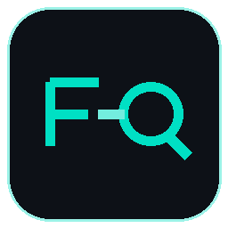
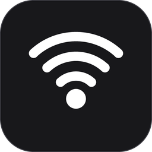
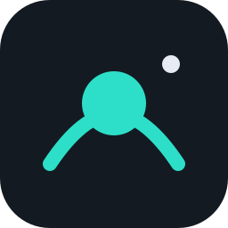

<h1 align="center">Hi 👋, I'm Muhammad Abu Huraira</h1>
<h3 align="center">Computer Science graduate Student at FAST NUCES | AI, Mobile (Flutter) & SaaS Engineer</h3>

<p align="left">
  
</p>

<div style="border: 1px solid #30363d; border-radius: 12px; padding: 16px; margin-bottom: 24px; background-color: rgba(13, 17, 23, 0.4);">
  <h2>About Me</h2>
  <ul>
    <li>🌱 Building full-stack <b>SaaS Platforms</b>, cross-platform <b>Flutter</b> apps, and <b>AI / Computer Use Agents</b>.</li>
    <li>📫 How to reach me: <b>huraira.eqeel@gmail.com</b></li>
    <li>⚡ Fun Fact: <b>I think I am a tech enthusiast building end-to-end autonomous systems</b>.</li>
  </ul>
</div>

<!-- TOP FEATURED PROJECTS (6 ICONS SHOWCASE) -->
# 🌟 Top Projects & Platforms

<table align="center" width="100%">
  <tr>
    <td align="center" width="16.6%" valign="top">
      <a href="https://github.com/hurairamuzammal/Field-Quote">
        <br/>
        <b>FieldQuote</b>
      </a><br/>
      <sub>Complete AI Quoting & Operations SaaS Platform</sub>
    </td>
    <td align="center" width="16.6%" valign="top">
      <a href="https://github.com/hurairamuzammal/WiFi-Sync">
        <br/>
        <b>WiFi Sync</b>
      </a><br/>
      <sub>Sub-Second Cross-Device Clipboard & Remote Hub</sub>
    </td>
    <td align="center" width="16.6%" valign="top">
      <a href="https://github.com/hurairamuzammal/linux-lumen">
        <br/>
        <b>Lumen</b>
      </a><br/>
      <sub>Native Linux Digital Wellbeing & Battery Telemetry</sub>
    </td>
    <td align="center" width="16.6%" valign="top">
      <a href="https://github.com/hurairamuzammal/notlyfe">
        <br/>
        <b>Notlyfe</b>
      </a><br/>
      <sub>Student Course & Note-Taking Academic Hub</sub>
    </td>
    <td align="center" width="16.6%" valign="top">
      <a href="https://github.com/hurairamuzammal/Cricket-world">
        <br/>
        <b>Cricket World</b>
      </a><br/>
      <sub>Live Match Analytics & ML Win Predictor</sub>
    </td>
    <td align="center" width="16.6%" valign="top">
      <a href="https://github.com/hurairamuzammal/localcua">
        <br/>
        <b>LocalCUA</b>
      </a><br/>
      <sub>Local Computer Use Agent & Automation</sub>
    </td>
  </tr>
</table>

---

# 🛠️ Tech Stack 


---

# 📈 Activity


---

# 🗺️ Portfolio Repository Map

```
📦 Muhammad Abu Huraira - Full Stack & Systems Engineer
│
├── ☁️ SaaS & Full-Stack Systems
│   └── FieldQuote (Complete Commercial Quoting & Operations SaaS)
│       ├── Voice Dictation & Multi-Image Ingestion (Whisper + Cloudflare R2)
│       ├── Multi-Modal AI Proposal Generation (GLM-4.5V / Claude 3.5)
│       ├── Strict Deterministic Pricing Guardrails & Price Book Engine
│       └── Contractor Dispatch, Stripe Payments & Realtime Sync (Bubble + Supabase)
│
├── 📱 Flutter & Mobile Ecosystem
│   ├── WiFi-Sync (Sub-Second Multi-Device Hub & Clipboard Sync Platform)
│   ├── Notlyfe_App (Student Productivity & Note Organization Platform)
│   ├── Cricket_News_App (Live Analytics, Scraped Feed & ML Win Predictor)
│   └── Flutter_Firebase_Projects
│
├── 🤖 AI / ML Stack
│   └── AI_ML-Projects_Collection
│       ├── GENAI-Qwen2-vl-finetuning-ocr
│       ├── GENAI-GANS-sketch-to-image
│       ├── GENAI-LSTM-BiLSTM-image_captioning
│       ├── NLP-Transformer_using_Pytorch
│       ├── NLP_Finetuning_Bert_GPT2_T5
│       ├── NLP-LSTM_BiLSTM-Urdu_to_RomanUrdu
│       └── NLP-RAG-medical-LLM
│
├── 💻 Autonomous Agents & Desktop Systems
│   ├── linux-lumen (Native Linux Digital Wellbeing & Battery Telemetry in C11 / GTK 4)
│   ├── localcua (Local Computer Use Agent with Action Guardrails)
│   └── WiFi_Sync_daemon (Linux systemd agent & SNI system tray)
│
├── 💾 DevOps & Software Testing
│   ├── localcua_mini_testing
│   ├── text-editor_testing
│   └── ST-LocalCUA-mutation-testing
│
├── ☕ Android Java
│   ├── Firebase_RecyclerView_App
│   ├── Camera_OCR_Android_App
│   └── Student_Management_App
│
└── 🖥️ .NET Desktop Applications (WinForms)
    ├── Flex_managment_system
    ├── Airline Managment Systtem
    └── Dictionary
```

---

## 📊 Repository Overview

| Stack | Key Repositories | Focus Area |
|:------|:-----------------|:-----------|
| **☁️ SaaS / Cloud** | **Field-Quote** | Complete AI-Driven Field Service Quoting SaaS (Bubble.io, Cloudflare R2, Supabase) |
| **📱 Mobile & IoT** | **WiFi-Sync**, **notlyfe**, **Cricket-world** | Cross-Platform Flutter Apps, Sub-Second Clipboard Sync, Real-Time Cloud |
| **🤖 AI / ML** | **AI_ML-Projects_Collection**, **NLP-RAG-medical-LLM** | Vision Models, LLM Finetuning, Whisper Audio Transcription, RAG Systems |
| **💻 Autonomous Agents** | **linux-lumen**, **localcua** | Native C11 / GTK 4 Telemetry, Local Computer Use Agents, Linux Desktop Integration |
| **💾 DevOps & Quality** | **ST-LocalCUA-mutation-testing**, **Text-Editor-ST** | Mutation Testing, Automated Test Suites, Code Verification |
| **☕ Android & .NET** | **Java-Android-Tasks**, **Flex-Managment-System** | Native Android Fundamentals, Enterprise WinForms Desktop Systems |

**Total Repositories: 25+ Production & Engineering Projects**
